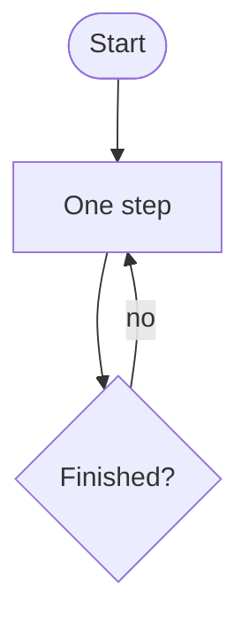

# Blog posts

Each post is a single Markdown file in `src/content/blog/`, and the file's
name, without `.md`, becomes the post's address; `first-author-culture.md`, for
example, is served at `/blog/first-author-culture`. The layout of the page,
with the navigation, the date, the title, and the footer, is the same for every
post and is drawn from the file, so a post involves no code. The blog index
lists the posts newest first.

How-to posts and reference notes belong on the notes site,
<https://quasinormal-notes.vercel.app/>, not on the blog.

## Writing a post

1. Copy `src/content/blog/_template.md` and rename the copy, using lowercase
   words joined by hyphens, such as `my-new-post.md`.
2. Fill in the block at the top, called the frontmatter:

   ```md
   ---
   title: "Post title"
   description: "One-line summary, shown on the blog index and in previews"
   date: "October 18, 2026"
   ---
   ```

   The title is shown as the post's heading, so the text that follows starts
   with the first paragraph. The date may also be written as `2026-10-18`, as
   in Jekyll. The reading time is estimated from the length of the post, at
   about 200 words a minute; a line such as `readingTime: "5 min read"` in the
   frontmatter replaces the estimate.
3. Replace the sample text with the post, written in Markdown.
4. Preview the post at `http://localhost:3000/blog/my-new-post`. If the
   development server does not show a new post, restart it (see
   [Previewing and publishing](README.md#previewing-and-publishing-a-change)).

## Drafts

A post that is not ready to be published is kept as a draft in
`src/content/drafts/`, written in the same way as a post. While the site runs
with `npm run dev`, drafts appear on the blog index, marked as drafts, and at
their addresses, such as `/blog/my-new-post`. The production build,
`npm run build`, which Vercel runs, leaves them out.

Git ignores everything in `src/content/drafts/` except its README, and the
drafts' images in `public/drafts/`, so drafts are never committed. They
therefore appear neither on the live site nor on GitHub, where the repository
is public. For the same reason, Git does not back them up; they exist only on
the computer on which they were written.

To publish a draft, move its file into `src/content/blog/` and its images, if
any, into `public/blog/`:

```sh
mv src/content/drafts/my-new-post.md src/content/blog/
mv public/drafts/my-new-post public/blog/
```

The post is then committed and pushed like any other change.

## Writing in Markdown

Posts are plain Markdown, so `{` and `<` need no escaping.

- **Links**: `[text](https://...)`. Links to other sites open in a new tab.
- **Mathematics**: `$e^{i\pi} + 1 = 0$` inline, and a `$$ ... $$` block for a
  displayed equation, as in LaTeX.
- **Quotations**: start the lines with `>`.
- **A horizontal rule**: a line with `---` and blank lines around it.
- **Code, algorithms, and diagrams**: fenced blocks, described in the next
  sections.
- **Notes to oneself**: text between `<!--` and `-->` is not shown.

## Code

A fenced code block, with the language after the opening backticks, is shown
in the code font, on a tinted background, with its syntax colored and a
button that copies it:

````md
```python
def f(x):
    return x**2
```
````

The languages colored are Python, Julia, C, C++, Fortran, Bash (`bash`,
`shell`, or `sh`), LaTeX (`latex` or `tex`), Mathematica (`mathematica` or
`wolfram`), Haskell, MATLAB, JavaScript, TypeScript, JSON, YAML, TOML,
Markdown, and diffs (`diff`). Further languages from Prism, the highlighter,
are added in `src/components/blocks/code-block/prism-languages.ts`; code in
any other language is shown without colors.

## Algorithms

A block whose language is `algorithm` is drawn like the algorithm environment
of LaTeX, with numbered lines:

````md
```algorithm
Algorithm 1: Euler's method
Input: $f$, $y_0$, and the step $h$
for $n = 0$ to $N - 1$ do
    $y_{n+1} \gets y_n + h f(y_n)$  // one step
end for
return $y_N$
```
````

A first line that begins with `Algorithm` is the caption, and lines that begin
with `Input:`, `Output:`, `Require:`, or `Ensure:` are shown above the
numbered lines. Indentation is kept, keywords such as `for`, `if`, and
`return` are set in bold, `$...$` is typeset as mathematics, and text after
`//` is shown as a comment.

## Diagrams

A block whose language is `mermaid` is drawn as a diagram, in the colors of
the site, and is drawn again when the theme changes:

````md

````

The syntax of flowcharts, sequence diagrams, and the other kinds is described
at <https://mermaid.js.org>. Diagrams are drawn in the browser, and the
library that draws them is loaded only on pages that contain one.

## Images

Put a post's images in `public/blog/<name>/`, where `<name>` is the name of the
post's file without `.md` (for a draft, in `public/drafts/<name>/`), and
include them by file name:

```md

```

The text in square brackets describes the image for screen readers. The
caption, in quotation marks, is optional; it appears under the image and may
contain links written as `[text](address)`. A full path, such as
`/covers/book.jpg`, or the address of an image on another site, also works.
Shrink large images first (see [Images](README.md#images)).

## Plots

Plots are drawn with Matplotlib in the amore style,
<https://github.com/subhodeeps/amore.mplstyle>, in its default, light
version, which serves for both themes of the site. `scripts/dev-env.sh plots`
makes the Python environment `.venv/` and installs amore into it; amore also
needs LaTeX. The script that draws a post's plots is kept in `aux/<name>/`,
which Git ignores, as it is not part of the site. It saves each figure as a
PNG about 1600 pixels across, which for amore's standard figure means
`amore.save(fig, "public/blog/<name>/figure", dpi=270, formats=("png",))`,
and the post then includes the figure as an image. It is run from the root
of the site:

```bash
.venv/bin/python aux/my-new-post/plot.py
```

The figures of a draft go in `public/drafts/<name>/`, which Git also ignores.

## Link previews

When a post is shared on social media or in a chat, the preview shows the
image `public/og/<name>.jpg` if it exists, or else the site's default image,
`public/og/default.jpg`.
